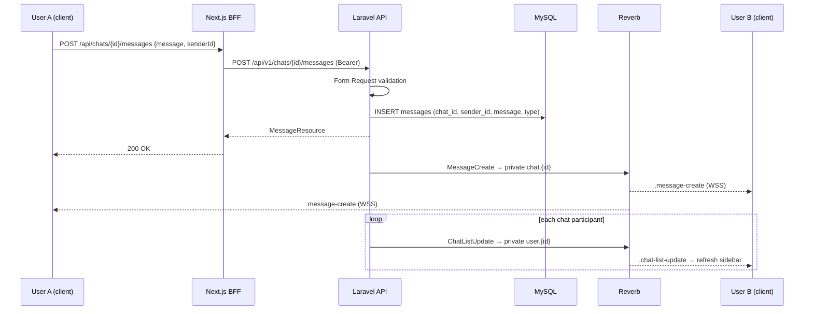

# ChatN — API

The **backend** for ChatN: a real-time chat and video calling API built on **Laravel 13**. It exposes a versioned REST API (`/api/v1/**`), pushes realtime events over **Laravel Reverb** WebSockets, and orchestrates audio/video calls on **LiveKit** (SFU).

This repository is the API sibling of the Next.js frontend (`chatn-frontend`) — see [`chatn-web-README.md`](https://github.com/nayhtetkhant/chatn-web) for the client side.

---

## Table of contents

- [Architecture](#architecture)
- [Request lifecycle](#request-lifecycle)
- [Message flow](#message-flow)
- [Call flow](#call-flow)
- [Realtime channels and events](#realtime-channels-and-events)
- [HTTP API surface](#http-api-surface)
- [Data model](#data-model)
- [Project structure](#project-structure)
- [Tech stack](#tech-stack)
- [Environment variables](#environment-variables)
- [Getting started](#getting-started)
- [Docker](#docker)
- [Tests](#tests)
- [Notes / current limitations](#notes--current-limitations)

---

## Architecture

Three planes are kept separate:

- **Control plane** — REST endpoints (`app/Http/Controllers/api/v1`) validate input with Form Requests, call Services, persist with Eloquent, and answer through API Resources wrapped in a `successResponse()` envelope.
- **Signalling plane** — Services `broadcast()` domain events (`app/Events`); **Laravel Reverb** fans them out to subscribed clients over private channels (`user.{id}`, `chat.{id}`). Clients authorise a channel with `POST /api/broadcasting/auth` (Sanctum-protected).
- **Media plane** — calls never carry audio/video through Laravel. The API creates a **LiveKit room**, mints a **JWT access token** per participant, and hands both to the clients over Reverb; the clients then publish/subscribe media directly against the LiveKit SFU.

Room membership lives in **Redis** (set-based presence), durable state lives in **MySQL**, and **laravel-http-beacon** records incoming/outgoing HTTP traffic for debugging.

```mermaid
flowchart TB
    subgraph Clients["Clients"]
        WEB["Next.js web client (chatn-frontend)<br/>route handlers + server actions"]
        MOB["Mobile / third-party API clients"]
    end

    subgraph Laravel["Laravel 13 API — this repo"]
        direction TB
        MW["Middleware<br/>auth:sanctum · Form Request validation"]
        CTRL["Controllers — api/v1<br/>auth · users · friends · chats · messages · calls"]
        SVC["Services<br/>AuthService · ChatService · MessageService<br/>CallService · FriendService"]
        ROOM["Room layer<br/>RoomManager · RoomValidator · RoomCache"]
        EVT["Broadcast events<br/>chat-create · message-create · call-create/accept/invite …"]
        MW --> CTRL --> SVC
        SVC --> ROOM
        SVC -->|broadcast()| EVT
        CTRL --> RES["Resources<br/>JSON shape + successResponse envelope"]
    end

    subgraph Realtime["Realtime"]
        REVERB["Laravel Reverb<br/>WebSocket server"]
    end

    subgraph Media["Media"]
        LK["LiveKit SFU<br/>rooms · JWT access tokens"]
    end

    subgraph Data["Data stores"]
        MYSQL[(MySQL)]
        REDIS[("Redis<br/>rooms:list · room:{{name}} · user:{{id}}")]
    end

    BEACON["laravel-http-beacon<br/>incoming / outgoing request log + dashboard"]

    WEB -->|"REST /api/v1/** + Bearer"| MW
    MOB --> MW
    SVC --> MYSQL
    ROOM <-->|"presence sets"| REDIS
    ROOM -->|"RoomServiceClient (HTTP)"| LK
    EVT --> REVERB
    REVERB <==|"WSS private channels<br/>user.[id] · chat.[id]"| WEB
    REVERB -.->|"POST /api/broadcasting/auth"| MW
    WEB -->|"token + roomName"| LK
    LK <==|"WebRTC media (publish / subscribe)"| WEB
    MW -.-> BEACON
```

### Why the room layer is separate

| Class | Responsibility |
|---|---|
| `RoomManager` | One entry point for `createRoom` / `createToken` / `removeRoom` / `busyUser`; composes the three pieces below. |
| `RoomValidator` | Rules: a room can't be created twice, a user can't join a full room (`MAX_ROOM_MEMBERS`, default 20) and can't sit in two rooms at once, an already-busy user can't be invited. |
| `RoomCache` | Redis set bookkeeping — `rooms:list`, `room:{name}` (members), `user:{id}` (rooms per user). Source of truth for presence and for `GET /users/busy`. |
| `Livekit\RoomService` / `TokenService` | Thin wrappers over `agence104/livekit-server-sdk`: create/delete rooms over the LiveKit HTTP API, mint join JWTs with publish/subscribe grants. |

---

## Request lifecycle

```
HTTP request
  └─ auth:sanctum (Bearer token) ──► Form Request (validation)
        └─► Controller (thin)
              └─► Service (business rules, ChatService::isAccessChat access checks)
                    ├─► Eloquent / DB transaction  ──► API Resource
                    ├─► RoomManager ──► Redis + LiveKit
                    └─► broadcast(Event) ──► Reverb ──► subscribed clients
```

Controllers stay thin; services own transactions and access checks (`ChatService::isAccessChat()` throws if the authenticated user or a named participant is not in the chat).

---

## Message flow



Message history is **cursor paginated** (`cursorPaginate(30)`, newest first). Nothing is rendered optimistically — sender and receivers both react to `.message-create`.

---

## Call flow

```mermaid
sequenceDiagram
    participant A as Caller
    participant L as Laravel API
    participant R as Reverb
    participant B as Callee
    participant K as Redis
    participant LK as LiveKit

    A->>L: POST /chats/{chat}/calls {requesterId}
    L->>DB: INSERT calls (status=pending)
    L->>LK: createRoom("room-{chatId}-{callId}")
    L->>K: SADD rooms:list
    L->>R: CallCreate → private user.{participant} (skips busy users)
    R-->>B: .call-create → incoming-call dialog

    B->>L: POST .../calls/{call}/accept {roomName, requesterId, accepterId}
    L->>LK: mint JWT for caller and accepter
    L->>R: CallAccept → private user.{id} (twice)
    R-->>A: .call-accept {token, roomName, callId, chatId}
    R-->>B: .call-accept {token, roomName, callId, chatId}
    A->>LK: Room.connect(url, token)
    B->>LK: Room.connect(url, token)

    A->>L: POST .../success {participantId, roomName}
    L->>DB: status=Accepted, sync call_participants
    L->>K: SADD room:{name}, SADD user:{id}

    opt third participant
        A->>L: POST .../invite {participantId, roomName}
        L->>R: CallInvite → private user.{participant}
        B->>L: POST .../inviteAccept
        L->>LK: mint JWT → CallAccept
    end

    A<==>: WebRTC media through the LiveKit SFU ==>B

    A->>L: POST .../onHangUp {participantId, roomName}
    L->>K: SREM participant
    alt last participant left
        L->>LK: deleteRoom
        L->>K: DEL room + user sets
        L->>DB: calls.ended_at = now()
    end
    L-->>A: {ok: true}
```

`GET /api/v1/users/busy` returns the user IDs currently present in any room (straight from the Redis sets) so clients can grey out users who are already in a call.

---

## Realtime channels and events

Channels are authorised in `routes/channels.php`; broadcasting auth is mounted at `POST /api/broadcasting/auth` with the `auth:sanctum` middleware.

| Channel | Authorisation | Used for |
|---|---|---|
| `user.{id}` (private) | only the matching user | call lifecycle + sidebar refresh |
| `chat.{id}` (private) | `return true` — any authed user ⚠️ | new messages |
| `chat-public` (public) | none | chat created / updated |
| `global` (public) | returns `{id, name}` | presence-style payloads |
| `App.Models.User.{id}` (private) | only the matching user | Laravel default, unused by the app |

| Event (`broadcastAs`) | Channel | Payload |
|---|---|---|
| `chat-create` | `chat-public` | `{ chat }` |
| `chat-update` | `chat-public` | `{ chat }` |
| `message-create` | `chat.{chatId}` | `{ message }` |
| `chat-list-update` | `user.{id}` | `{ chatListUpdate: true }` |
| `call-create` | `user.{id}` | `{ call, roomName }` |
| `call-accept` | `user.{id}` | `{ token, roomName, chatId, callId }` |
| `call-invite` | `user.{id}` | `{ call, roomName }` |

Event names are normalised by the `App\Enums\Event` enum; all events implement `ShouldBroadcast` and shape their payload with `broadcastWith()` through API Resources.

---

## HTTP API surface

Base path: `/api/v1`. Responses use the `successResponse()` envelope — `{ success, code, message, data }` — except `chats.messages.index`, which returns a raw resource collection.

### Public

| Method | Route | Notes |
|---|---|---|
| `POST` | `/auth/login` | `{userName, password}` → `{isSuccess, id, token}` (Sanctum plain-text token) |
| `GET` | `/auth/me` | current user |
| `POST` | `/auth/logout` | revoke the current token |

### Authenticated

| Method | Route | Notes |
|---|---|---|
| `GET` | `/users` / `POST` | stubs (empty) |
| `GET` | `/users/{user}` | user profile |
| `GET` | `/users/busy` | user IDs currently in a call |
| `GET` | `/friends?type=all\|commonFriend\|bestFriend\|partner\|family` | friend list |
| `GET` | `/chats` | chats with participants + last message |
| `POST` | `/chats` | create chat (seeds a first system message) |
| `GET`/`PUT` | `/chats/{chat}` | show / update |
| `GET` | `/chats/{chat}/messages` | cursor paginated, 30 per page |
| `POST` | `/chats/{chat}/messages` | send message → `message-create` |
| `GET` | `/chats/{chat}/messages/{message}` | single message |
| `POST` | `/chats/{chat}/calls` | create call + LiveKit room → `call-create` |
| `POST` | `/chats/{chat}/calls/{call}/accept` | issue tokens → `call-accept` |
| `POST` | `/chats/{chat}/calls/{call}/success` | mark accepted, register presence |
| `POST` | `/chats/{chat}/calls/{call}/invite` | invite a third user → `call-invite` |
| `POST` | `/chats/{chat}/calls/{call}/inviteAccept` | token for the invitee |
| `POST` | `/chats/{chat}/calls/{call}/onHangUp` | leave room; deletes room when empty |

---

## Data model

```
users ──< chat_participants >── chats ──< messages
   │                               ├──< admins >── users (group admins)
   │                               └──< calls ──< call_participants >── users
   ├──< friends >── users            (userA_id ↔ userB_id, type: commonFriend|bestFriend|partner|family)
   ├──< friend_requests >── users    (initiator_id ↔ approver_id, status: pending|accepted|rejected)
   └── personal_access_tokens        (Sanctum)
beacon_incoming_requests · beacon_outgoing_requests · beacon_shared_links   (HTTP traffic log)
```

Enums (`app/Enums`): `ChatType` (`p2p`/`group`), `CallType` (`audio`/`video`), `CallRequestStatus` (`pending`/`Accepted`/`rejected`/`timeOut`), `MessageType`, `FriendType`, `FriendRequestStatus`, `Event`.

---

## Project structure

```
app/
├── Enums/                    # ChatType, CallType, CallRequestStatus, Event, FriendType, …
├── Events/                    # 7 ShouldBroadcast events (chat · message · call)
├── Helpers/helpers.php        # successResponse()
├── Http/
│   ├── Controllers/api/v1/    # AuthController · UserController · FriendController
│   │                          # ChatController · MessageController · CallController
│   ├── Requests/api/v1/       # Form Requests — one per write operation
│   └── Resources/api/v1/      # UserResource · ChatResource · MessageResource
│                              # CallResource · FriendListResource · ParticipantResource
├── Models/                    # User · Chat · Message · Call · CallParticipant
│                              # ChatParticipant · Friend · FriendRequest · Admin
├── Services/
│   ├── Livekit/               # RoomService (LiveKit rooms) · TokenService (join JWT)
│   ├── Room/                  # RoomManager · RoomValidator · RoomCache (Redis)
│   └── User/                  # AuthService · ChatService · MessageService
│                              # CallService · FriendService · UserService
├── Utils/Response.php         # success / error envelope
bootstrap/app.php              # routing, broadcasting prefix (/api), Sanctum auth
config/                        # reverb.php · beacon.php · broadcasting.php
│                              # services.php (livekit) · database.php · queue.php
database/
├── migrations/                # users, friends, friend_requests, chats, chat_participants,
│                              # admins, calls, call_participants, messages, tokens, beacon_*
├── factories/                 # UserFactory (user_name + password "password"), Chat, Call, …
└── seeders/                   # local-only demo data: 20 users, chats, messages, calls, friends
routes/
├── api.php                    # /api/v1 endpoints
├── channels.php               # broadcast channel authorisation
├── web.php                    # welcome view only
└── console.php
resources/js/echo.js           # Echo + pusher-js client pointed at Reverb (VITE_REVERB_*)
dockerfile.laravel             # php:8.4-fpm image (pdo_mysql, redis, composer)
startLaravel.sh                # entrypoint — installs the Caddy root CA if present
```

---

## Tech stack

| Layer | Choice |
|---|---|
| Framework | [Laravel 13](https://laravel.com) (PHP ≥ 8.3), App Router-style `bootstrap/app.php` wiring |
| Auth | [Laravel Sanctum](https://laravel.com/docs/sanctum) — Bearer personal access tokens, `auth:sanctum` on the API **and** on `/api/broadcasting/auth` |
| Realtime | [Laravel Reverb](https://laravel.com/docs/broadcasting) + Laravel Echo (broadcast events, private channels) |
| A/V | [LiveKit](https://livekit.io) via `agence104/livekit-server-sdk` (room REST API + join JWTs) |
| Presence | Redis sets (`RoomCache`) — room list, room members, rooms per user |
| Database | MySQL (Eloquent, transactions, cursor pagination) |
| Queue / logs | database queue + `php artisan pail` (`composer dev` runs them together) |
| Observability | [`tintaungkhant/laravel-http-beacon`](https://github.com/tintaungkhant/laravel-http-beacon) — sampled incoming/outgoing HTTP logging with a dashboard |
| Tests | [Pest 4](https://pestphp.com) |

---

## Environment variables

`.env.example` covers the Laravel defaults (MySQL `chatn`, database cache/sessions/queue, `BROADCAST_CONNECTION=log`). For realtime and calls you must add:

```bash
# App
APP_NAME=ChatN
APP_KEY=                          # php artisan key:generate
APP_URL=http://localhost:8000

# MySQL
DB_CONNECTION=mysql
DB_HOST=127.0.0.1
DB_PORT=3306
DB_DATABASE=chatn
DB_USERNAME=root
DB_PASSWORD=

# Realtime — Laravel Reverb
BROADCAST_CONNECTION=reverb
QUEUE_CONNECTION=database
REVERB_APP_KEY=your-app-key
REVERB_APP_SECRET=your-app-secret
REVERB_APP_ID=your-app-id
REVERB_HOST=localhost
REVERB_PORT=8080                  # REVERB_SERVER_PORT for the WS listener
REVERB_SERVER_HOST=0.0.0.0
REVERB_SERVER_PORT=8080
REVERB_SCHEME=http

# Browser-visible Echo settings (resources/js/echo.js)
VITE_REVERB_APP_KEY=your-app-key
VITE_REVERB_HOST=localhost
VITE_REVERB_PORT=8080
VITE_REVERB_SCHEME=http

# LiveKit
LIVEKIT_HOST=wss://livekit.example.com
LIVEKIT_API_KEY=devkey
LIVEKIT_SECRET_KEY=devsecret
MAX_ROOM_MEMBERS=20

# Redis — required for call presence (RoomCache)
REDIS_HOST=127.0.0.1
REDIS_PORT=6379

# laravel-http-beacon (optional)
BEACON_ENABLED=true
BEACON_SAMPLING_RATE=1.0
```

> ⚠️ `.env.example` does **not** ship the `REVERB_*`, `VITE_REVERB_*` or `LIVEKIT_*` keys yet — copy them from above.

---

## Getting started

### Prerequisites

- PHP 8.3+ and [Composer](https://getcomposer.org)
- MySQL 8
- Redis (call presence will fail without it)
- A running [Laravel Reverb](https://laravel.com/docs/broadcasting) server for realtime
- A [LiveKit](https://livekit.io) server for media
- Node.js 18+ (only for Vite assets / the Echo snippet)

### Run locally

```bash
composer setup     # install, copy .env, key:generate, migrate, npm install, vite build
composer dev       # serve + queue worker + pail logs + vite (concurrently)
```

Or manually:

```bash
cp .env.example .env
php artisan key:generate
php artisan migrate
composer install
npm install && npm run build
php artisan serve        # API on http://localhost:8000
php artisan reverb:start # WebSocket server (separate terminal)
php artisan queue:listen # broadcast/queue worker (separate terminal)
```

Seed demo data (local environment only — 20 users with `user_name` like `@user_abc12` and password `password`, chats, messages, calls, friends):

```bash
php artisan db:seed
```

Then log in:

```bash
curl -X POST http://localhost:8000/api/v1/auth/login \
  -H 'Content-Type: application/json' \
  -d '{"userName":"@user_abc12","password":"password"}'
```

and reuse the returned `token` as `Authorization: Bearer <token>`.

---

## Docker

```bash
docker build -f dockerfile.laravel -t chatn-api .
docker run -p 9000:9000 chatn-api
```

The image is `php:8.4-fpm` with `pdo_mysql`, `zip`, `pcntl` and the **redis** extension, Composer 2 baked in, and `composer install --no-dev` at build time. `startLaravel.sh` (the entrypoint) installs a Caddy root CA from `/ca-certs/caddy-root.crt` when the volume is mounted — the app is intended to run behind a Caddy reverse proxy — then execs `php-fpm` on port 9000.

---

## Tests

```bash
composer test      # php artisan test
```

Only the default Pest example tests exist so far (`tests/Feature`, `tests/Unit`); `phpunit.xml` runs against in-memory SQLite with broadcasting set to `null`.

---

## Notes / current limitations

- **`chat.{id}` is not really private** — `routes/channels.php` returns `true` for every authenticated user, so any logged-in account can subscribe to any chat's message stream. Same for `chat-public`: it is a public channel carrying chat create/update payloads. Tighten both before production.
- **Friend routes are ahead of their controller** — `routes/api.php` registers `friends.store` / `friends.destroy`, but `FriendController` only implements `index`; calling them returns a 500.
- **Stub endpoints** — `users.index/store/update/destroy` and `calls.index/show/update/destroy` (plus `messages.update`) are empty method bodies; `chats` is routed as a full `apiResource` but `ChatController` has no `destroy`.
- **Room presence is Redis-only** — if Redis is flushed mid-call, `onHangUp` / `users/busy` lose track of the room and the LiveKit room is never deleted. There is no reconciliation against `listRooms()`.
- **`.env.example` is incomplete** — see [Environment variables](#environment-variables); `BROADCAST_CONNECTION=log` means no client receives anything until you switch to `reverb`.
- **No rate limiting / call rejection model** — `CallRequestStatus` has `Rejected` and `TimeOut` cases but nothing writes them; rejected/missed calls are never persisted.
- **No media in the API** — file/attachment messages are not supported yet (`messages.message` is a string column only).
- **Access checks throw raw `Error`** rather than HTTP exceptions (`ChatService::isAccessChat`), so a failed check surfaces as a 500 instead of 403.
- **Stray dependencies** — `rubix/ml` is required in `composer.json` solely for an unused `ReLU` import in `RoomCache.php`; safe to drop both.
- **Single-server assumptions** — Reverb scaling (Redis pub/sub) and LiveKit clustering are configured for one node; `MAX_ROOM_MEMBERS` caps a room at 20 by default.

---

## Companion

- Frontend / BFF: [`chatn-frontend`](https://github.com/nayhtetkhant/chatn-web) — Next.js client, Laravel Echo + LiveKit UI.
