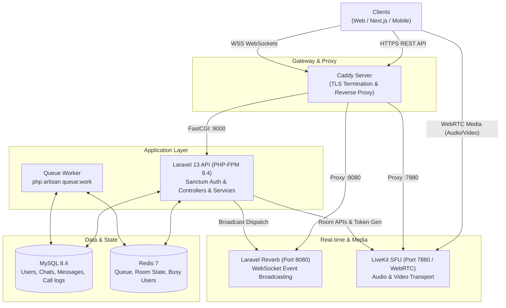
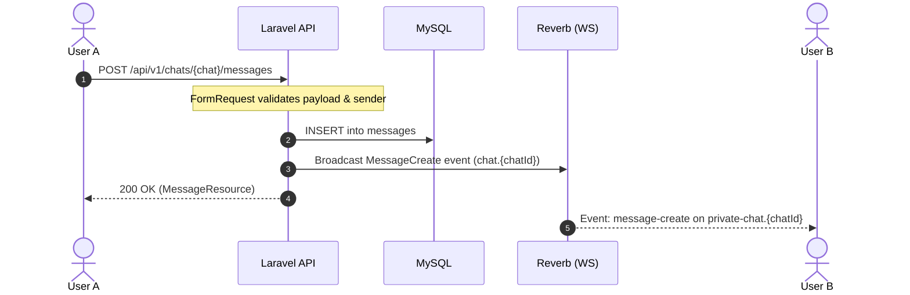
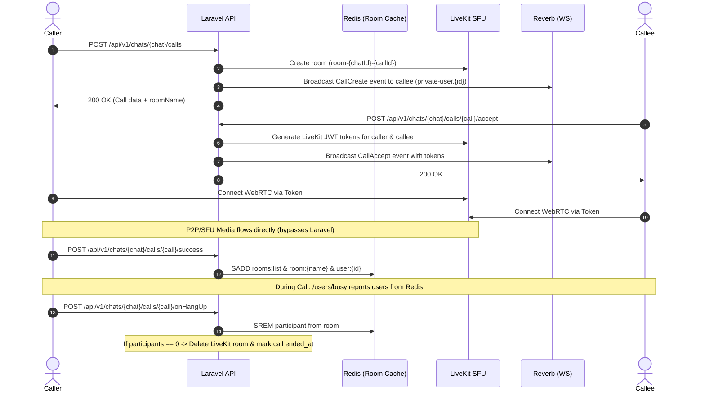

# chatN Backend API

REST API and real-time backend for the chatN application, built on Laravel 13.

It handles Sanctum authentication, friend lists, direct/group messaging, and call coordination. Real-time events (messages, call invites, presence) are pushed via **Laravel Reverb** WebSockets, while WebRTC audio/video streams route directly through **LiveKit SFU** with active room presence tracked in **Redis**.

---

## Architecture

### System Topology



---

### Request & Signaling Flows

#### 1. Real-Time Chat Message Flow



#### 2. Audio/Video Call Flow (LiveKit Signaling)



---

### Redis Room State Schema

Live call presence is maintained in Redis using Sets:

| Redis Key | Type | Description |
| --- | --- | --- |
| `rooms:list` | Set | List of all currently active LiveKit room names. |
| `room:{roomName}` | Set | User IDs currently connected to `{roomName}`. |
| `user:{userId}` | Set | Room names that `{userId}` is currently inside. |

Calling `GET /api/v1/users/busy` reads all members from active rooms to prevent ringing a user already in a call.

---

## Tech Stack

- **PHP 8.3 / 8.4** & **Laravel 13**
- **MySQL 8.4** (Relational storage: users, chats, messages, calls)
- **Redis 7** (In-memory room state, cache, queues)
- **Laravel Reverb** (First-party WebSockets)
- **LiveKit Server** (`agence104/livekit-server-sdk` for room tokens)
- **Laravel Sanctum** (Bearer token API authentication)

---

## Environment Setup

### Environment Variables (.env)

Make sure your `chatn-backend/.env` contains these critical keys:

```dotenv
APP_NAME=chatN
APP_ENV=local
APP_KEY=                    # Generate via php artisan key:generate
APP_DEBUG=true
APP_URL=http://localhost:8000

# Database
DB_CONNECTION=mysql
DB_HOST=127.0.0.1           # Use 'mysql' if running inside docker network
DB_PORT=3306                # Host port 3310 if connecting to compose MySQL
DB_DATABASE=chatn
DB_USERNAME=root
DB_PASSWORD=root

# Cache, Queue & Redis
QUEUE_CONNECTION=redis
CACHE_STORE=redis
REDIS_CLIENT=phpredis
REDIS_HOST=127.0.0.1        # Use 'redis' inside docker
REDIS_PORT=6379             # Host port 6380 if connecting to compose Redis
REDIS_PASSWORD=null

# Reverb WebSockets
BROADCAST_CONNECTION=reverb
REVERB_APP_ID=chatn-app
REVERB_APP_KEY=chatn-key
REVERB_APP_SECRET=chatn-secret
REVERB_HOST=127.0.0.1       # Reverb bind/client host
REVERB_PORT=8080
REVERB_SCHEME=http

# Client-facing Echo vars
VITE_REVERB_APP_KEY="${REVERB_APP_KEY}"
VITE_REVERB_HOST="${REVERB_HOST}"
VITE_REVERB_PORT="${REVERB_PORT}"
VITE_REVERB_SCHEME="${REVERB_SCHEME}"

# LiveKit SFU
LIVEKIT_HOST=http://127.0.0.1:7880
LIVEKIT_API_KEY=devkey
LIVEKIT_SECRET_KEY=devsecret
MAX_ROOM_MEMBERS=20
```

---

## Running the Application

### Option 1: Full Stack via Docker Compose (Recommended)

From the project root directory (`chatN/`):

```bash
# 1. Start all containers (MySQL, Redis, Laravel, Reverb, LiveKit, Caddy)
docker compose up -d

# 2. Run migrations and seed sample data inside the Laravel container
docker compose exec laravel php artisan migrate --seed

# 3. View container status
docker compose ps
```

The stack exposes:
- **API**: `https://api.<DOMAIN_NAME>.nip.io` (or FastCGI via Caddy)
- **WebSockets**: `wss://ws.<DOMAIN_NAME>.nip.io`
- **LiveKit**: `https://live.<DOMAIN_NAME>.nip.io`

---

### Option 2: Local Native Development

If running PHP, MySQL, and Redis directly on your host machine:

#### 1. Install Dependencies & Generate Key

```bash
composer install
cp .env.example .env
php artisan key:generate
```

#### 2. Migrate and Seed

```bash
php artisan migrate
php artisan db:seed
```

> **Note on seeders:** Seeding generates 20 sample users with usernames like `@user_abc12` and default password `password`.

#### 3. Run Development Services

You need three terminal processes running:

```bash
# Terminal 1: HTTP API Server
php artisan serve --port=8000

# Terminal 2: Queue Worker (Required for broadcast event jobs)
php artisan queue:work

# Terminal 3: Reverb WebSocket Server
php artisan reverb:start --debug
```

*(Alternatively, use `composer run dev` if you have Node and `concurrently` installed).*

---

## Everyday Development Workflows

### 1. Create a Manual Test User

You can create an account directly in Tinker:

```bash
php artisan tinker
```

```php
\App\Models\User::factory()->create([
    'name' => 'Alice Dev',
    'email' => 'alice@test.local',
    'user_name' => '@user_alice',
    'password' => bcrypt('password123'),
]);
```

### 2. Inspecting Seeded Usernames

```bash
php artisan tinker --execute="\App\Models\User::pluck('user_name');"
```

### 3. Resetting Database State

```bash
php artisan migrate:fresh --seed
```

### 4. Clearing Caches & Redis State

```bash
php artisan optimize:clear

# Clear active room cache in Redis
redis-cli del rooms:list
```

---

## API Reference (`/api/v1`)

All endpoints except `POST /auth/login` require:
```http
Authorization: Bearer <your-sanctum-token>
Accept: application/json
Content-Type: application/json
```

### Standard Response Envelope

Responses return in this format:

```json
{
  "success": true,
  "code": "success",
  "message": "Success",
  "data": { ... }
}
```

---

### Endpoints Overview

| Method | Endpoint | Description | Payload / Notes |
| --- | --- | --- | --- |
| `POST` | `/auth/login` | Authenticate user & get bearer token | `{"userName": "@user_alice", "password": "..."}` |
| `GET` | `/auth/me` | Current authenticated user profile | Requires Sanctum token |
| `POST` | `/auth/logout` | Revoke current user token | Requires Sanctum token |
| `GET` | `/users/busy` | List user IDs currently active in calls | Reads directly from Redis |
| `GET` | `/users/{id}` | Get user details | Public user profile |
| `GET` | `/friends` | List friends by relationship filter | Query param: `?type=all` or `commonFriend`, `bestFriend`, `partner`, `family` |
| `GET` | `/chats` | List user's conversations | Includes last message & participants |
| `POST` | `/chats` | Create direct (p2p) or group chat | `{"chatName": "dev", "type": "p2p", "displayName": "Chat", "participants": [1, 2]}` |
| `GET` | `/chats/{chat}` | Chat details with members | Chat object |
| `PUT` | `/chats/{chat}` | Update chat name or attributes | Update payload |
| `GET` | `/chats/{chat}/messages` | Message history for a chat | Paginated / resource collection |
| `POST` | `/chats/{chat}/messages` | Send message & broadcast event | `{"message": "Hello", "type": "text", "senderId": 1}` |
| `POST` | `/chats/{chat}/calls` | Initiate a voice/video call | `{"requesterId": 1}` — Creates LiveKit room |
| `POST` | `/chats/{chat}/calls/{call}/accept` | Accept incoming call | `{"requesterId": 1, "accepterId": 2, "roomName": "..."}` |
| `POST` | `/chats/{chat}/calls/{call}/success` | Confirm connection | `{"participantId": 2, "roomName": "..."}` — Adds to Redis |
| `POST` | `/chats/{chat}/calls/{call}/invite` | Invite participant to call | `{"participantId": 3, "roomName": "..."}` |
| `POST` | `/chats/{chat}/calls/{call}/inviteAccept` | Accept call invitation | `{"userId": 3, "roomName": "..."}` |
| `POST` | `/chats/{chat}/calls/{call}/onHangUp` | Leave call / hang up | `{"participantId": 1, "roomName": "..."}` |

---

## Real-Time WebSocket Events (Reverb)

### Channels

- **`private-chat.{chatId}`**: Broadcasts messages and chat updates to chat members.
- **`private-user.{userId}`**: Broadcasts direct signaling (incoming calls, room invitations, personal notifications).
- **`presence-global`**: Tracks global user presence.

### Channel Authorization

WebSocket subscriptions authenticate via:
```http
POST /api/broadcasting/auth
Authorization: Bearer <sanctum-token>
```

### Event List & Payloads

| Event Name | Channel | Payload |
| --- | --- | --- |
| `message-create` | `private-chat.{chatId}` | `{"message": { "id": 1, "message": "Hey", "senderId": 1, ... }}` |
| `call-create` | `private-user.{userId}` | `{"call": { ... }, "roomName": "room-1-42"}` |
| `call-accept` | `private-user.{userId}` | `{"token": "<livekit-jwt>", "roomName": "room-1-42", "call": { ... }}` |
| `call-invite` | `private-user.{userId}` | `{"call": { ... }, "roomName": "room-1-42"}` |
| `chat-create` | `private-user.{userId}` | New chat resource |
| `chat-list-update` | `private-user.{userId}` | Updated chat overview |

---

## Testing & Code Quality

Run the test suite:

```bash
composer test
# or
php artisan test
```

Format code using Laravel Pint:

```bash
vendor/bin/pint
```
